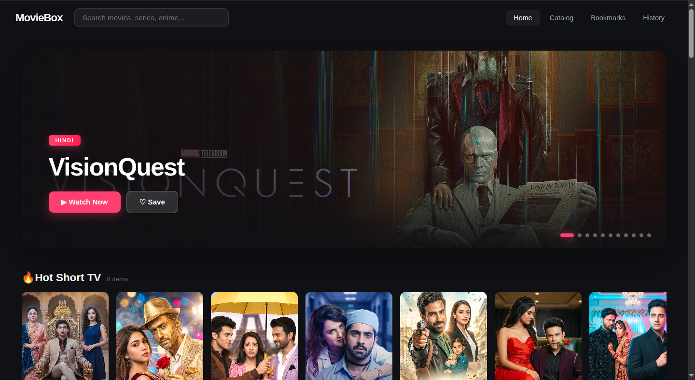
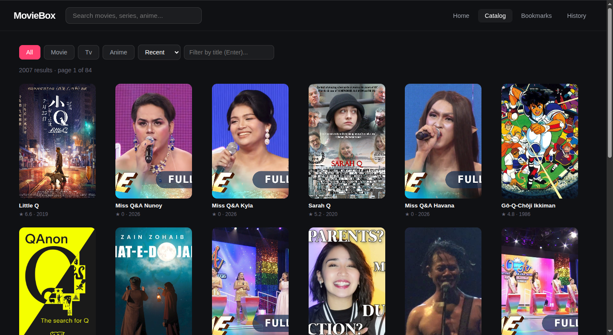
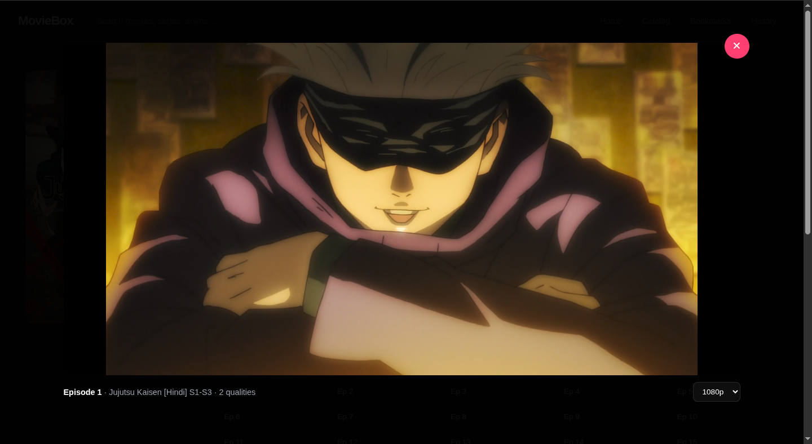

<p align="center">
  
</p>

<p align="center">
  <a href="https://github.com/faisaljs/Moviebox-API"></a>
  <a href="https://github.com/faisaljs"></a>
  <a href="LICENSE"></a>
  <a href="https://github.com/faisaljs/Moviebox-API/stargazers"></a>
</p>

# MovieBox API Pro

A pure REST API wrapper around [moviebox.ph](https://moviebox.ph) with an indexed catalog, provider failover, FTS5 search, and a self-hosted frontend.

No scraping. No HTML parsing. No headless browser. It talks the exact same private JSON API the moviebox web player talks — `h5-api.aoneroom.com/wefeed-h5api-bff` — and re-exposes it as a clean, self-hosted REST surface plus a browser UI.

Built for people who want to wire moviebox into their own apps, scripts, bots, dashboards, or media servers without reverse-engineering the network tab every time the site ships an update.

**Version 2.9.1** — fixes for CLI database placement, catalog enrichment, provider diagnostics bounds, safer local network defaults, and Docker packaging.

---

## What it does

- **Discovery** — banners, featured blocks, and every category row from the moviebox home feed
- **Indexed catalog** — SQLite-backed, 1700+ subjects across movies / TV / anime, self-refreshing on a 6h schedule
- **Full-text search** — FTS5-powered title search with prefix matching and rank ordering
- **Search** — full-text search + typeahead suggestions against upstream
- **Metadata** — full detail tree for any subject (episodes, seasons, languages, cast, trailer, artwork)
- **Streams** — direct MP4 sources per resolution, plus HLS and DASH manifests
- **Stream proxy** — Range-aware MP4 passthrough for media servers
- **Subtitles** — full caption list per episode, SRT→VTT conversion inline
- **Provider failover** — 7 known mirrors, circuit breaker per host, automatic fallover
- **Web frontend** — hero carousel, catalog browser, player with resume / quality / subtitle pickers, trailer playback, continue-watching, bookmarks, watch history
- **Diagnostics** — tab-ID probing, payload variant testing, raw upstream passthrough, health, SQLite integrity check on boot

## What it isn't

- Not a proxy for HLS/DASH manifests (MP4 only)
- Not a downloader (it hands you URLs, you decide what to do with them)
- Not affiliated with moviebox.ph
- Not a scraping tool — it depends on the upstream API staying reachable

---

## Quickstart

```bash
git clone https://github.com/faisaljs/Moviebox-API
cd Moviebox-API
pip install -r requirements.txt
python main.py
```

Server boots on `http://localhost:8000`. Two entry points:

- `http://localhost:8000/` — HTML API dashboard, one-click tests for every endpoint
- `http://localhost:8000/app` — the actual frontend (hero carousel, catalog, player, bookmarks, history)

Dev with autoreload:

```bash
RELOAD=1 python main.py
```

Custom port:

```bash
PORT=9000 python main.py
```

Docker:

```bash
cp .env.example .env
docker compose up -d
```

The Compose file loads settings from `.env`; create it from `.env.example` on
a fresh checkout before starting the container.

### Install the local CLI

On macOS or Linux with Python 3, `curl`, and `tar` installed:

```bash
curl -fsSL https://raw.githubusercontent.com/faisaljs/Moviebox-API/main/install.sh | sh
moviebox
```

The installer keeps the app and its Python environment under
`~/.local/share/moviebox`, and puts the `moviebox` launcher in `~/.local/bin`.
The command starts the server on `127.0.0.1:8000`, opens `/app` in your browser,
and stays in the terminal until you press Ctrl+C. The catalog database is stored
in the same per-user data directory. Use `moviebox --no-browser` to skip opening
the page, or `moviebox --port 8001` if port 8000 is already in use.

The app reads `.env` from the current directory, then
`$XDG_CONFIG_HOME/moviebox/.env`, then the app source directory. Set
`MOVIEBOX_ENV_FILE` to choose a specific file. Variables already exported in
the shell take precedence over values from the file.

At startup, the CLI checks GitHub Releases at most once every 24 hours and
prints a notice when a newer version is available. Install that release with
`moviebox update`; check the installed version with `moviebox version`.

Update an existing installation from the latest GitHub Release with:

```bash
moviebox update
```

To repair or reinstall from the current `main` branch, rerun the installer:

```bash
curl -fsSL https://raw.githubusercontent.com/faisaljs/Moviebox-API/main/install.sh | sh
```

The first boot kicks off the catalog walk in the background. It takes 2–3 minutes to populate ~1700 rows and enrich the type fields. `/catalog/stats` shows progress.

**Single instance only.** SQLite is not multi-writer safe across processes. Two `python main.py` against one `catalog.db` corrupts it. If you're testing, `Ctrl+C` the running server before starting a new one.

---

## Endpoints

### Discovery & home

| Method | Path                | Purpose                           |
| ------ | ------------------- | --------------------------------- |
| `GET`  | `/home`             | Featured sections and banners     |
| `GET`  | `/home/all`         | Flattened deduped feed            |
| `GET`  | `/sections`         | List every home section           |
| `GET`  | `/browse/{section}` | Direct access to any home section |

### Catalog (indexed)

| Method | Path               | Purpose                                              |
| ------ | ------------------ | ---------------------------------------------------- |
| `GET`  | `/catalog`         | Indexed catalog with sort/filter/search              |
| `GET`  | `/catalog/stats`   | Counts, walk progress, keyword telemetry             |
| `POST` | `/catalog/refresh` | Re-run the walk (`?mode=enrich` for enrichment only) |
| `POST` | `/catalog/add`     | Manually add a subject by slug                       |

### Home-fallback catalogs

| Method | Path         | Purpose                      |
| ------ | ------------ | ---------------------------- |
| `GET`  | `/movies`    | Movies from home sections    |
| `GET`  | `/tv-series` | TV series from home sections |
| `GET`  | `/animation` | Animation from home sections |

### Search & metadata

| Method | Path              | Purpose                              |
| ------ | ----------------- | ------------------------------------ |
| `GET`  | `/search`         | Full-text search against upstream    |
| `GET`  | `/search/suggest` | Typeahead (`?enrich=true` for slugs) |
| `GET`  | `/detail/{slug}`  | Full metadata for a subject          |

### Stream & subtitles

| Method | Path                                        | Purpose                     |
| ------ | ------------------------------------------- | --------------------------- |
| `GET`  | `/api/stream/{subject_id}`                  | Direct video sources        |
| `GET`  | `/api/stream/{subject_id}/proxy`            | Range-aware MP4 passthrough |
| `GET`  | `/api/stream/{subject_id}/captions`         | Subtitle list               |
| `GET`  | `/api/stream/{subject_id}/subtitles/{lang}` | SRT → VTT inline            |

### Providers

| Method | Path               | Purpose                                         |
| ------ | ------------------ | ----------------------------------------------- |
| `GET`  | `/providers`       | Live provider health with circuit breaker state |
| `POST` | `/providers/probe` | Force-probe all providers now                   |
| `POST` | `/providers/reset` | Clear all circuit breakers                      |
| `GET`  | `/api/hosts`       | Backwards-compat host status                    |

### Diagnostics

| Method | Path                  | Purpose                               |
| ------ | --------------------- | ------------------------------------- |
| `GET`  | `/health`             | Liveness, cache state, catalog counts |
| `GET`  | `/api/tabs`           | Probe tab IDs (diagnostic)            |
| `GET`  | `/api/tabs/variants`  | Try every known filter payload shape  |
| `GET`  | `/api/debug/upstream` | Raw upstream passthrough              |

---

### `GET /home`

Returns the operating list from the moviebox home feed, grouped into sections. Banner sections and `SUBJECTS_*` rows are normalized into the same item shape.

```bash
curl http://localhost:8000/home | jq
```

```json
{
  "status": "success",
  "host": "moviebox.ph",
  "sections": [
    {
      "section": "Banner",
      "count": 11,
      "items": [
        {
          "name": "VisionQuest",
          "poster_url": "https://.../cover.webp",
          "slug": "visionquest-hindi-0qVaGP1YHE4",
          "subject_id": "3908280950886646112",
          "badge": "Hindi"
        }
      ]
    }
  ]
}
```

### `GET /catalog`

The real catalog. Reads from the SQLite index populated by the background walk.

**Query parameters**

| Param      | Type   | Default  | Notes                                  |
| ---------- | ------ | -------- | -------------------------------------- |
| `type`     | string | `all`    | `all`, `movie`, `tv`, `anime`          |
| `sort`     | string | `recent` | `recent`, `title`, `rating`            |
| `page`     | int    | `1`      | 1-indexed                              |
| `per_page` | int    | `24`     | Max 100                                |
| `q`        | string | —        | FTS5 title search (with LIKE fallback) |
| `host`     | string | —        | Filter by source host                  |

```bash
curl "http://localhost:8000/catalog?type=movie&sort=rating&per_page=5" | jq
curl "http://localhost:8000/catalog?q=dragon" | jq
curl "http://localhost:8000/catalog?q=love%20you" | jq   # multi-word AND
```

Response includes `total`, `total_pages`, and `items[]` with `name`, `poster_url`, `slug`, `subject_id`, `rating`, `year`, `badge`, `subject_type`, `genre`, `types[]`.

**FTS5 search behavior:**

- Multi-word queries AND'd (`love you` finds titles with both)
- Prefix matching (`matri` matches `matrix`)
- Rank-ordered (best match first)
- 1-char queries fall back to LIKE (SQLite FTS5 needs ≥2 chars to be useful)
- If FTS setup ever fails at import time, `q=` silently degrades to `LIKE %query%` — same results, slower

### `GET /catalog/stats`

Everything about the index:

```json
{
  "total": 1737,
  "movies": 163,
  "tv": 140,
  "anime": 25,
  "untyped": 1409,
  "untyped_pending_enrichment": 1497,
  "subject_types": { "1": 119, "2": 89, "6": 23 },
  "by_host": { "moviebox.ph": 1737 },
  "walk_state": { "running": false, "enriching": false },
  "keyword_stats": {
    "m": { "pages": 11, "items": 211, "hit_cap": false, "upstream_total": 211 }
  }
}
```

### `POST /catalog/refresh`

```bash
curl -X POST http://localhost:8000/catalog/refresh                          # full walk
curl -X POST "http://localhost:8000/catalog/refresh?mode=enrich"            # enrichment only
curl -X POST "http://localhost:8000/catalog/refresh?force=true"             # walk all hosts, no dedupe
```

Returns immediately; runs in background. Watch `/catalog/stats`.

### `POST /catalog/add?slug=`

Manually add a subject the walk missed. Useful for anything upstream's search ranking doesn't surface (`Matrix` was the case study — search for `m` returns 211 results but Matrix isn't among them).

```bash
curl -X POST "http://localhost:8000/catalog/add?slug=matrix-W1E5680Y2S5" | jq
```

Fetches the detail response, upserts, and enriches immediately.

### `GET /api/stream/{subject_id}`

```bash
curl "http://localhost:8000/api/stream/6207982430134357800?detail_path=breaking-bad-ej6Bp0MCAo7&se=1&ep=1" | jq
```

Returns `has_resource`, `sources[]` (resolution, format, codec, url, size, duration), `hls[]`, `dash[]`, `free_episodes`, `limited`.

### `GET /api/stream/{subject_id}/proxy`

Range-aware MP4 passthrough. Drop into media servers (Jellyfin, Plex, Infuse, VLC) that can't set custom headers.

```bash
# full file
curl -O "http://localhost:8000/api/stream/6207982430134357800/proxy?detail_path=breaking-bad-ej6Bp0MCAo7&res=1080p"

# ranged seek
curl -H "Range: bytes=0-1048575" "http://localhost:8000/api/stream/.../proxy?..." -o chunk.bin
```

Forwards `Range` upstream, returns `206` with `Content-Range` on partial. Full-file requests stream through a 64KB chunked iterator.

### `GET /api/stream/{subject_id}/subtitles/{lang}`

Fetches the SRT, strips index lines, converts timestamps, prepends `WEBVTT`. Drop-in for a `<track>` element.

```bash
curl "http://localhost:8000/api/stream/6207982430134357800/subtitles/en?detail_path=breaking-bad-ej6Bp0MCAo7" | head -20
```

```vtt
WEBVTT

00:00:17.833 --> 00:00:18.916
[Vision] <i>Who am I?</i>
```

SRT formatting tags (`<i>`, `<b>`, `{\an8}`) survive the conversion.

### `GET /providers`

Live provider state:

```json
{
  "default_host": "moviebox.ph",
  "provider_count": 7,
  "healthy": 7,
  "degraded": 0,
  "providers": [
    {
      "host": "moviebox.ph",
      "alive": true,
      "circuit_open": false,
      "circuit_open_for": 0,
      "consecutive_failures": 0,
      "total_success": 25,
      "total_failure": 0,
      "avg_latency_ms": 374,
      "last_success_ago": 0,
      "last_failure_ago": null,
      "last_error": null
    }
  ],
  "circuit_breaker": { "threshold": 3, "window_seconds": 60 }
}
```

### `GET /health`

```json
{
  "status": "ok",
  "version": "2.9.1",
  "default_host": "moviebox.ph",
  "providers": {
    "moviebox.ph": {
      "alive": true,
      "latency_ms": 374,
      "fails": 0,
      "circuit_open": false
    }
  },
  "tokens_cached": 1,
  "domain_cached": "https://mzfi.me",
  "domain_expires_in": 287,
  "catalog_indexed": 1737,
  "walk_running": false,
  "enriching": false
}
```

---

## Frontend at `/app`

Single-file vanilla JS, no build step, no dependencies. Served by the same FastAPI process.

**Views:**

- **Home** — hero carousel (auto-rotating, arrows, dots, Ken Burns zoom on the backdrop), followed by continue-watching (deduped by show, position ≥ 30s, top 8), recommendations, then horizontal scroll rows for every home section
- **Catalog** — type tabs (All/Movies/TV/Anime), sort dropdown, FTS title filter, pagination
- **Bookmarks** — everything you've hearted, sorted by save time, "Clear all" button
- **History** — every episode you've watched with progress bar and resume button
- **Detail** — poster, description, metadata, cast, dubs, Play button or season/episode grid, bookmark toggle, trailer button (when available), watched-episode dots
- **Player** — modal overlay with quality picker, subtitle picker, resume-from-history, keyboard shortcuts, episode picker on missing streams

**Persistence** (server-side SQLite):

- `user_bookmarks` — saved titles
- `user_history` — watch progress per `(slug, se, ep)`

This is a single-user personal app: every client connected to one server shares
the same bookmarks and watch history. The API does not authenticate users or
partition this data. If you expose it beyond your own devices, put an
authenticated reverse proxy in front of it; use a separate identity-aware
deployment if multiple people need independent libraries.

**Trailer playback** — when `subject.trailer.videoAddress.url` exists, a `▶ Trailer` button appears next to Bookmark on the detail page. Opens a minimal overlay with the promo MP4. No history tracking.

**Player keyboard shortcuts:**

| Key           | Action                         |
| ------------- | ------------------------------ |
| `Space` / `k` | Play / pause                   |
| `←` / `→`     | Seek ±5s                       |
| `↑` / `↓`     | Volume ±10%                    |
| `f`           | Fullscreen                     |
| `m`           | Mute                           |
| `Esc`         | Close player / exit fullscreen |

---

### Screenshots





More at [`screenshots/`](screenshots/).

---

## Architecture

### Module layout

```
config.py            env vars + headers + constants
state.py             mutable globals (client, db, tokens, caches, walk_state)
providers.py         provider health, circuit breaker, probe loop
upstream.py          token cache, bff_request (failover), player, stream resolution
storage.py           sqlite schema, FTS5, read, upsert, classify
helpers.py           normalize, srt_to_vtt, pick_mp4_stream
catalog_worker.py    walk, enrichment, maintenance loop
dashboard.py         DASHBOARD_HTML string
routes/              APIRouter handlers grouped by feature
main.py              FastAPI app + lifespan + middleware + / and /app
static/app.html      frontend
```

No circular imports. Import order: `config → state → providers → upstream → catalog_worker → routes → main`. `storage` and `helpers` are leaf modules.

The rule throughout: `import state` / `import providers` — never `from state import client`. Mutable references stay live via module attribute access.

### Guest tokens per provider

Each mirror issues its own guest JWT via the `x-user` response header. Tokens are cached per host. On 401, the token is cleared, re-acquired, and the request retried once on the same host.

### Player domain

Stream URLs live on a different host than the BFF. Fetched from `/media-player/get-domain`, cached for 300s. On stream failure, the cache is invalidated and the domain re-discovered once before surfacing an error.

### Provider failover

Every BFF request tries the primary first, then falls over to the next healthy provider on network failure, 5xx, 429 (honoring Retry-After), or non-JSON. Per-host circuit breaker opens after 3 consecutive failures for 60s. A background probe loop cycles one host per `PROVIDER_PROBE_INTERVAL` seconds, keeping latency and health fresh.

All 7 known mirrors share the same aoneroom backend — the failover is pure resilience, not multiple catalogs.

### Catalog walk

Two-tier source for the index:

1. **Home ingest** — every subject appearing in `/home` under a category section gets tagged with `is_movie` / `is_tv` / `is_anime` based on substring matching against the section name
2. **Keyword walk** — 36 keywords (a-z, 0-9), paginate until `hasMore: false` or `CATALOG_MAX_PAGES_PER_KEYWORD`, upsert every subject

After walking, a background enricher hits `/detail/{slug}` for every subject whose type is unknown and reads `subjectType` (1=movie, 2=series, 6=music video) plus `genre` (contains "anime" → `is_anime`). This is what gets movies from 44 to 400+ and TV from 60 to 300+.

The walk re-runs every 6 hours. Enrichment runs once after each walk. `POST /catalog/refresh` forces both manually.

**Home feed is geo-targeted.** Mumbai sees `Cinema`, `Bollywood`, `Top Anime`. Singapore sees `Popular Movie`, `K-Drama`, `Anime[English Dubbed]`. The classifier uses substring matching (`movie`, `series`, `anime`, etc.) so both work. Genre-named sections (Comedy, Epic Fantasy, BL Story) fall through to enrichment.

### FTS5 search

`subjects_fts` is an FTS5 virtual table using external content mode — it mirrors the `subjects` table via triggers (`subjects_fts_ai/ad/au`). On first boot, if the row counts drift, `init_schema` rebuilds the FTS index. From then on, triggers keep it in sync on every insert/update/delete.

Query path: `/catalog?q=` calls `storage.fts_search()` which returns matching subject_ids or `None`. `None` (FTS unavailable or short query) → fall back to `title LIKE ?`. Empty list (FTS ran, no matches) → `WHERE 1 = 0`. Non-empty list → `subject_id IN (...)`.

### SQLite integrity check

On boot, right after `init_schema`, the lifespan runs `PRAGMA integrity_check`. If the DB is corrupt, the process prints the fix command and exits(1) before uvicorn binds the port. This is the safety net for the case where you accidentally run two `python main.py` against the same `catalog.db` — better to fail loudly than silently on every write while reads succeed.

### SRT → VTT

`/subtitles/{lang}` fetches the SRT, strips numeric index lines, converts `,` timestamp separators to `.`, prepends `WEBVTT`, collapses whitespace. Italics and other SRT tags survive.

---

## Project layout

```
.
├── main.py
├── config.py
├── state.py
├── providers.py
├── upstream.py
├── storage.py
├── helpers.py
├── catalog_worker.py
├── dashboard.py
├── routes/
│   ├── user.py
│   ├── providers.py
│   ├── home.py
│   ├── catalog.py
│   ├── search.py
│   ├── stream.py
│   └── diagnostics.py
├── static/
│   └── app.html
├── requirements.txt
├── verify.py
├── Dockerfile
├── docker-compose.yml
├── README.md
├── CONTRIBUTING.md
├── .env.example
└── .gitignore
```

---

## Verification

`verify.py` runs a live integration pass against a running server. It chains real requests — pulls a slug from `/home`, feeds `/detail`, `/api/stream`, `/captions`, `/proxy`, `/subtitles`. It also exercises `/providers`, `/api/hosts`, catalog sorts, filters, FTS search, and user-data round trips.

```bash
# server must be running
python verify.py

# or against a remote host
python verify.py https://your-host
```

Exits non-zero on any failure. Drops straight into CI or a pre-commit hook.

---

## Environment

See `.env.example` for the full list with defaults. Key variables:

| Variable                        | Default       | Notes                                             |
| ------------------------------- | ------------- | ------------------------------------------------- |
| `PORT`                          | `8000`        | Listen port                                       |
| `RELOAD`                        | `0`           | `1` enables autoreload (dev)                      |
| `REQUEST_TIMEOUT`               | `25`          | Upstream timeout, seconds                         |
| `MOVIEBOX_BIND_HOST`            | `127.0.0.1`   | Bind address; Docker sets this to `0.0.0.0` inside its container |
| `CORS_ORIGINS`                  | empty         | Optional comma-separated trusted origins allowed for browser cross-origin API calls |
| `CATALOG_DB`                    | `catalog.db`  | SQLite path; the CLI stores this default under its per-user data directory |
| `CATALOG_REFRESH_INTERVAL`      | `21600`       | Walk re-run interval (6h)                         |
| `CATALOG_MAX_PAGES_PER_KEYWORD` | `50`          | Bump to 200 for deeper keyword coverage           |
| `ENRICH_RATE_LIMIT`             | `0.2`         | Seconds between `/detail` calls during enrichment |
| `MOVIEBOX_HOST`                 | `moviebox.ph` | Primary provider                                  |
| `MOVIEBOX_HOSTS`                | 7 mirrors     | Comma-separated                                   |
| `PROVIDER_PROBE_INTERVAL`       | `60`          | Seconds between probe ticks                       |
| `CIRCUIT_BREAKER_THRESHOLD`     | `3`           | Failures before host opens                        |
| `CIRCUIT_BREAKER_SECONDS`       | `60`          | How long host stays open                          |

Copy `.env.example` to `.env` to configure local runs. The app loads it
automatically; exported shell variables take precedence. Docker Compose also
passes `.env` into the container.

---

## Deployment notes

- **Network exposure** — direct runs bind to localhost, and Docker Compose publishes on localhost. To expose a deployment, deliberately change the bind/port settings and put authentication in front of it; this app has no user authentication.
- **CORS** — same-origin frontend use needs no CORS setting. Set `CORS_ORIGINS` only for specific trusted web clients.
- **Behind a reverse proxy** — forward the full path. Routes assume `/` as root.
- **Healthcheck** — point your orchestrator at `/health`.
- **Persist `catalog.db`** — mount it as a volume or the walk restarts on every container rebuild. The compose file already bind-mounts it.
- **Rate limits** — upstream is unauthenticated for guests. Heavy polling will get throttled.
- **Basic auth** — if exposing beyond localhost, put `auth_basic` in the nginx config from day one. See `CONTRIBUTING.md` for the threat model.
- **ToS** — you're calling a third party's private API. Behave accordingly.

---

## Troubleshooting

### `database disk image is malformed` in logs

Two processes running against one `catalog.db`. Stop the server, `lsof catalog.db` to find any orphan PIDs, kill them, then `rm -f catalog.db catalog.db-wal catalog.db-shm` and restart clean. The integrity check on boot will now catch this before the port is bound.

### `FATAL: catalog.db is corrupt` on boot

Same as above — the integrity check fired. Run the fix command it printed and restart.

### Catalog shows `total: 0` or stays at 44

The walk hasn't finished or enrichment is still running. `POST /catalog/refresh` and watch `/catalog/stats`. `walk_state.running` should flip to `true` within a second.

### `?type=movie` returns fewer results than expected

Enrichment hasn't finished. Only home-ingested subjects have type tags until enrichment runs. Watch `untyped_pending_enrichment` in `/catalog/stats` — when it hits 0, everything has a type.

### `/movies` and `/catalog?type=movie` show different counts

They're different tools. `/movies` is a home-section fallback (44 items from Cinema/Bollywood/etc.). `/catalog?type=movie` is the indexed DB (400+ items). Use `/catalog` for real browsing.

### Stream proxy returns 502

Upstream CDN might be blocking the referer. Check `/api/stream/{sid}` first — if sources are present, the URLs are live and the proxy should work. If empty, the episode may be gated or mid-upload.

### Search misses a known title

Upstream `/subject/search` is relevance-ranked, not exhaustive. `Matrix` isn't in the top 200 for `m`, so no walk keyword catches it. Fix: `POST /catalog/add?slug=<known-slug>` — the detail endpoint always works.

### Frontend `/app` 404

`static/app.html` missing. Confirm the file exists in the repo. `Dockerfile` copies `static/` explicitly.

---

## Changelog

**v2.9.1** — fix CLI catalog path selection, enrich home-ingested catalog entries, bound tab diagnostics, restrict cross-origin access and default network exposure, and include route modules in Docker images.

**v2.9.0** — check for new GitHub Releases, notify at startup, install updates with `moviebox update`, and publish releases automatically from version tags.

**v2.8.0** — per-user `moviebox` CLI installer, local-only server startup, browser launch, cleaner terminal output, and automatic `.env` loading.

**v2.7.0** — module split (10 files), provider failover with per-host circuit breakers, multi-host detection, `/providers` + `/providers/probe` + `/providers/reset`, FTS5 catalog search, trailer playback on detail pages, continue-watching row on home, SQLite integrity check on boot.

**v2.6.0** — multi-host probe, `?host=` on every BFF endpoint, `source_host` column in catalog.

**v2.4.1** — type enrichment from `/detail`, `keyword_stats` telemetry, `POST /catalog/add`, `?mode=enrich` refresh.

**v2.4.0** — indexed catalog (`/catalog`, `/catalog/stats`, `/catalog/refresh`), SQLite storage, background walk + enrichment.

**v2.3.3** — re-added `/` dashboard route; `/api/tabs/variants` confirms `/subject/filter` requires auth as guest.

**v2.3.2** — catalog home-fallback, `/sections`, `/browse/{section}`, fuzzy section matching.

**v2.3.1** — `/search/suggest` honesty (text-only upstream), `total_sentinel` flag, `?tab=` override, `/api/tabs`.

**v2.3.0** — shared `httpx.AsyncClient`, async-locked token init, retry with backoff, `/home/all`, `/api/stream/{sid}/proxy`, `/api/stream/{sid}/subtitles/{lang}`, Docker setup.

---

## Star History

<a href="https://www.star-history.com/?repos=faisaljs%2FMoviebox-API&type=date&legend=top-left">
 <picture>
   <source media="(prefers-color-scheme: dark)" srcset="https://api.star-history.com/chart?repos=faisaljs/Moviebox-API&type=date&theme=dark&legend=top-left" />
   <source media="(prefers-color-scheme: light)" srcset="https://api.star-history.com/chart?repos=faisaljs/Moviebox-API&type=date&legend=top-left" />
   
 </picture>
</a>

---

## Author

**Faisal** ([@faisaljs](https://github.com/faisaljs))

- GitHub: [github.com/faisaljs](https://github.com/faisaljs)
- Repo: [github.com/faisaljs/Moviebox-API](https://github.com/faisaljs/Moviebox-API)
- Issues / PRs: [github.com/faisaljs/Moviebox-API/issues](https://github.com/faisaljs/Moviebox-API/issues)

If you use this project, a star on GitHub is appreciated.

## License

MIT — see [LICENSE](LICENSE) for the full text.

---

Not affiliated with moviebox.ph. Provided as-is. You are responsible for how you use it.
