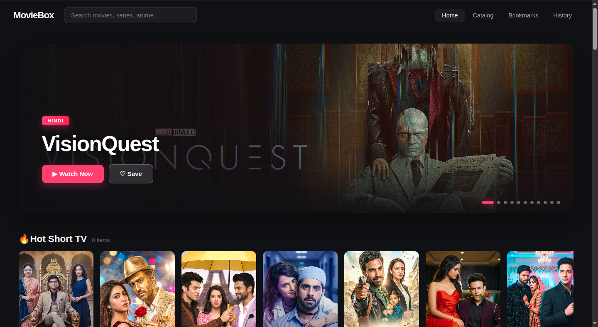
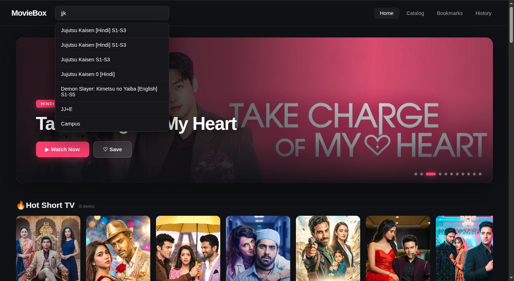
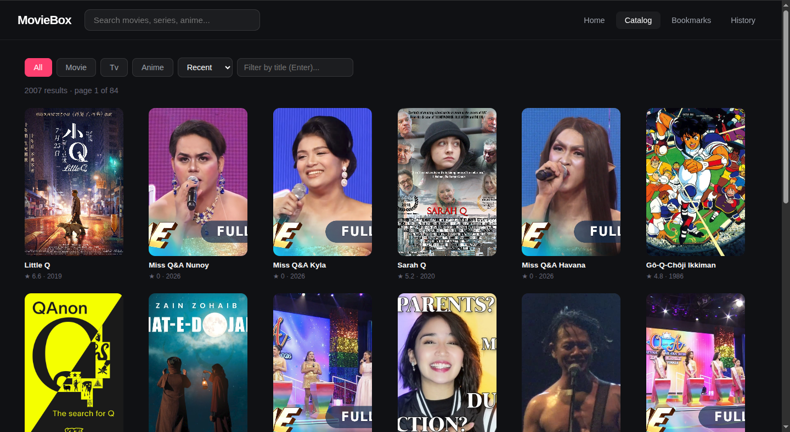
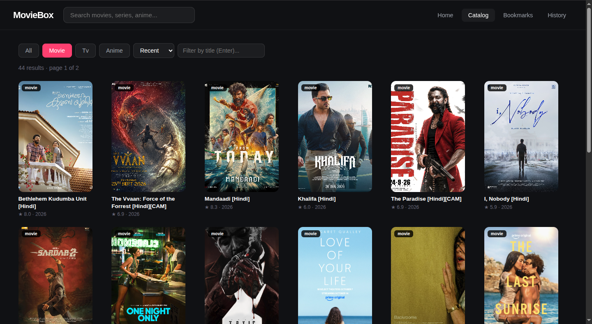
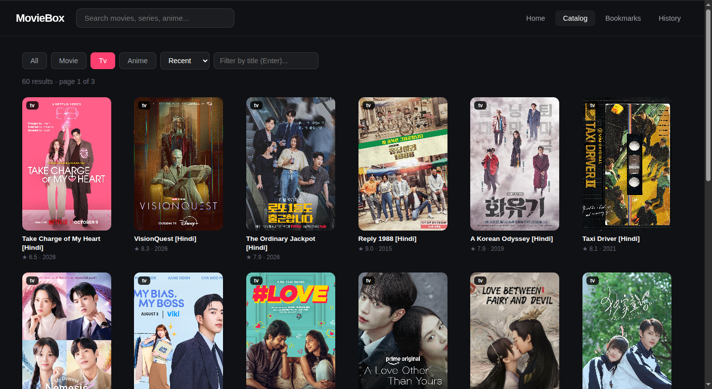
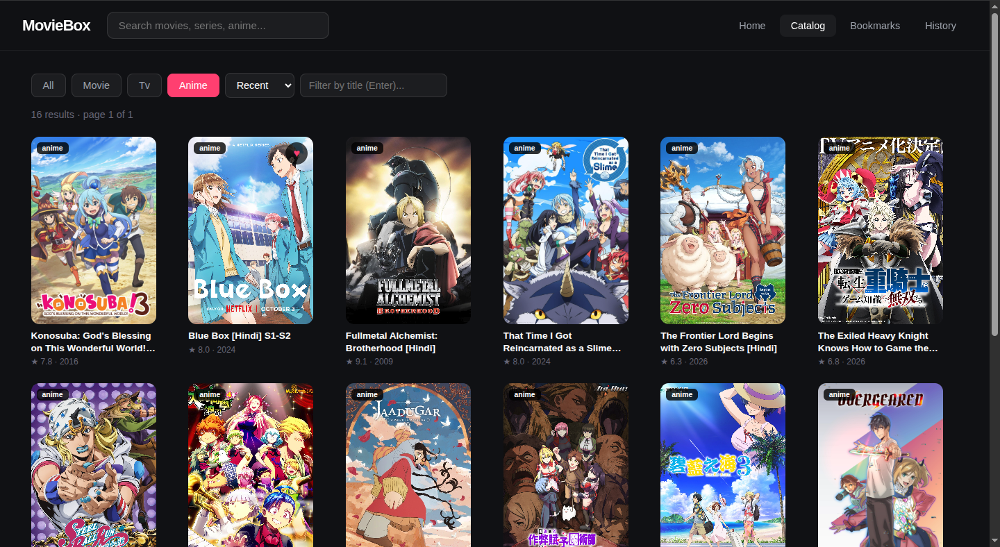
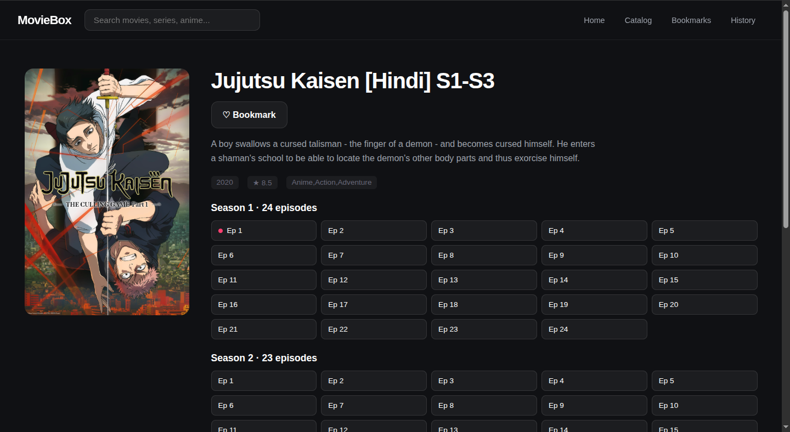
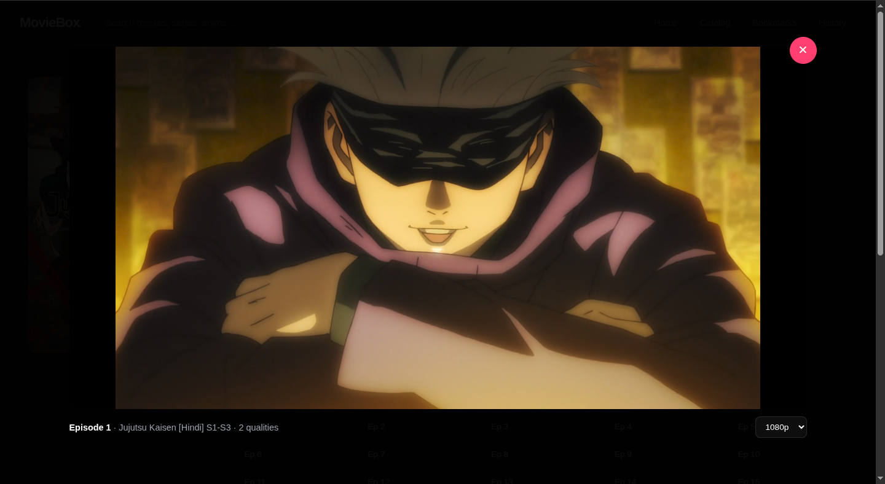
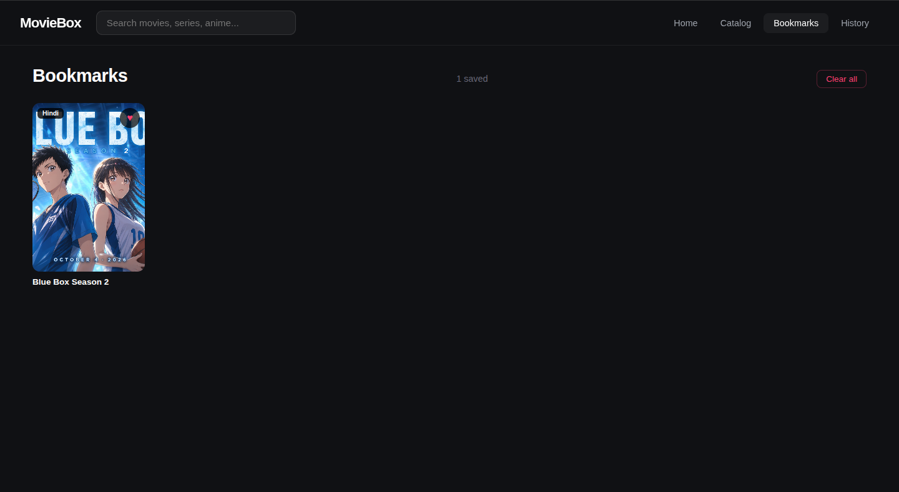
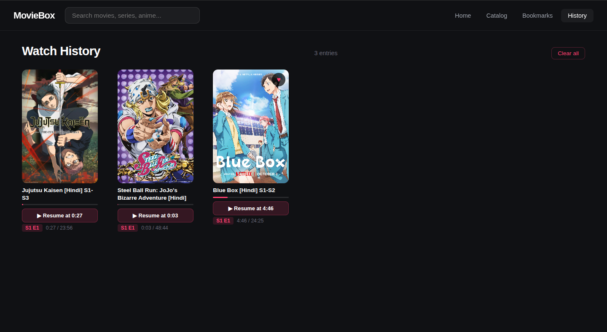

# Screenshots

Frames captured from a running instance of MovieBox API Pro. All images at
1440×900, browser zoom 100%, captured Nov 8 2026.

---

## Home

The landing page. Hero carousel at top, continue-watching row below (when
present), then every home section as a horizontal scroll row.

---

## Search

Header typeahead — hits `/search/suggest?enrich=true` after 300ms of typing,
shows matched titles as clickable links.

---

## Catalog

Grid view of the catalog. Type tabs, sort dropdown, grid/list toggle in the
toolbar.

### Filtered to movies

### Filtered to TV series

### Filtered to anime

---

## Detail / Episodes

Series detail page with season/episode grid. Poster, metadata, cast, dubs, and
play button (or episode list for series).

---

## Player

Modal overlay. HTML5 video through `/api/stream/{sid}/proxy` with Range
support. Quality picker, subtitle picker, prev/next episode buttons, resume
position, keyboard shortcuts.

---

## Bookmarks

Every card you've hearted, sorted by save time. Stored in the browser
(`localStorage` under `mb.bookmarks`), not on the server.

---

## Watch History

Every episode you've watched with progress bar, resume button, and
season/episode badge. Stored in the browser (`localStorage` under `mb.history`).

